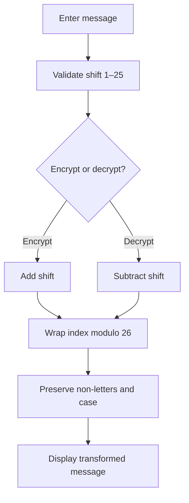

# Caesar Cipher

An interactive Caesar cipher implementation with a Python function and a browser-based interface. The web version runs entirely in the browser and does not send text to a server.


## Live interface

The GitHub Pages workflow is included. After enabling **Settings → Pages → Build and deployment → GitHub Actions**, the site will be available at:

[Open the interactive Caesar Cipher](https://aKmsdfhjb.github.io/Caesar-Cipher/)

## Features

- Encrypt and decrypt alphabetic text with a shift from 1 to 25.
- Preserve uppercase/lowercase, spaces, punctuation and digits.
- Validate shift input and copy the result.
- Responsive editorial interface using the project's ivory, serif, hairline-rule and vermilion metadata design.
- Browser implementation requires no API key or backend.

## How it works

Each letter is mapped to an alphabet index, shifted by the selected amount, then mapped back. Decryption applies the inverse shift.



## Run locally

Open `index.html` in a browser. To run the Python implementation:

```bash
python Caesar_Cipher.py
```

The reusable Python function is `caesar(text, shift, encrypt=True)`.

## Project structure

- `Caesar_Cipher.py` — Python cipher function and original CLI experiment.
- `index.html` — standalone interactive browser interface.
- `.github/workflows/pages.yml` — GitHub Pages deployment workflow.

## Documentation

The README contains the architecture and usage guide. Additional implementation notes can be kept in `docs/` and linked here. GitHub's separate Wiki feature must be enabled in repository settings before a native Wiki can be populated.

## Security note

A Caesar cipher is a historical substitution cipher and is trivially breakable. Use it only for learning and demonstrations, never for passwords, private messages or real security.

## License

No license file is currently included. The repository remains under its existing copyright status until a license is chosen.


## Project Wiki

- [Wiki home](docs/wiki/Home.md)
- [Architecture and deployment](docs/wiki/Architecture.md)

The repository keeps a version-controlled wiki source under `docs/wiki/`.